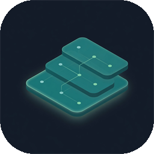
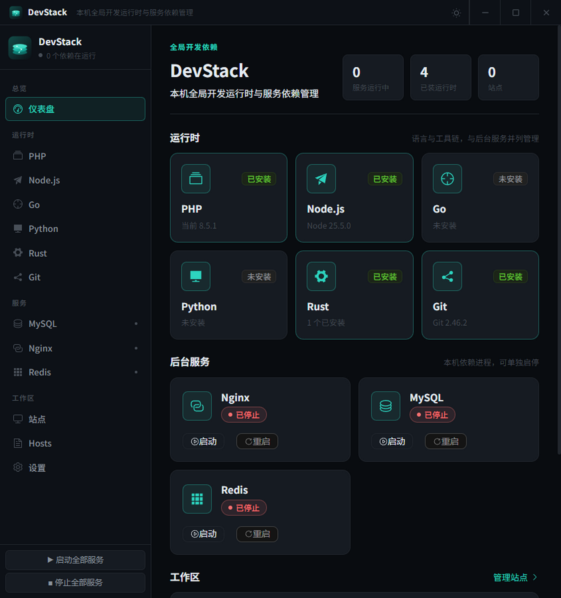
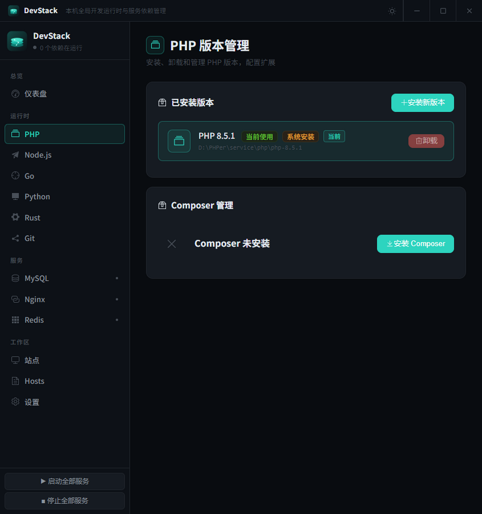
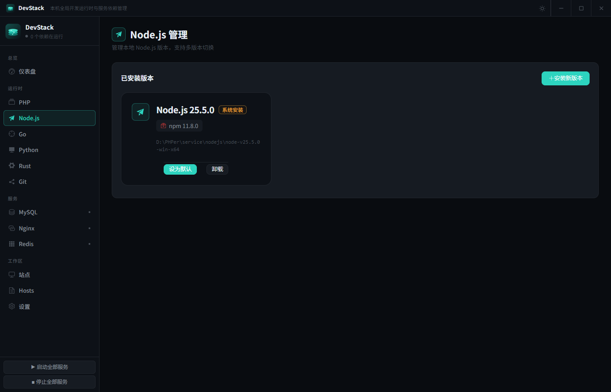
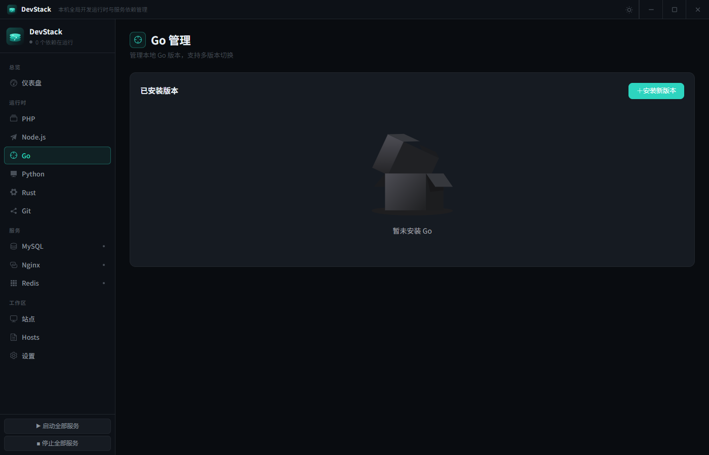
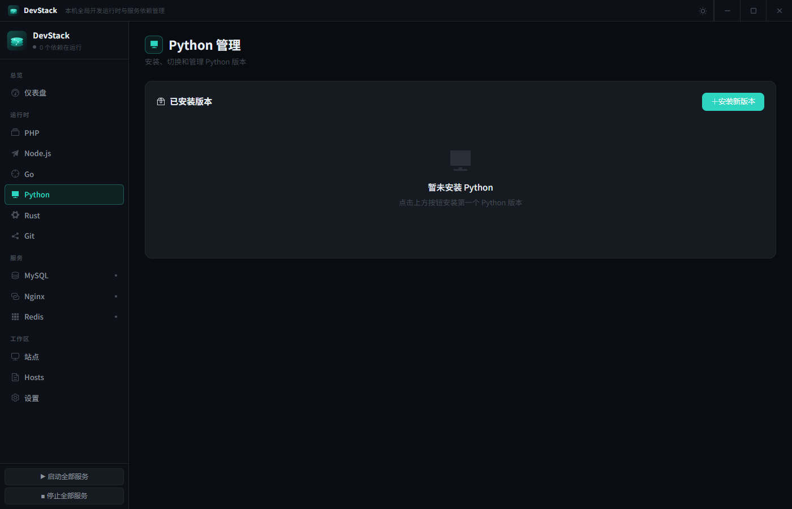
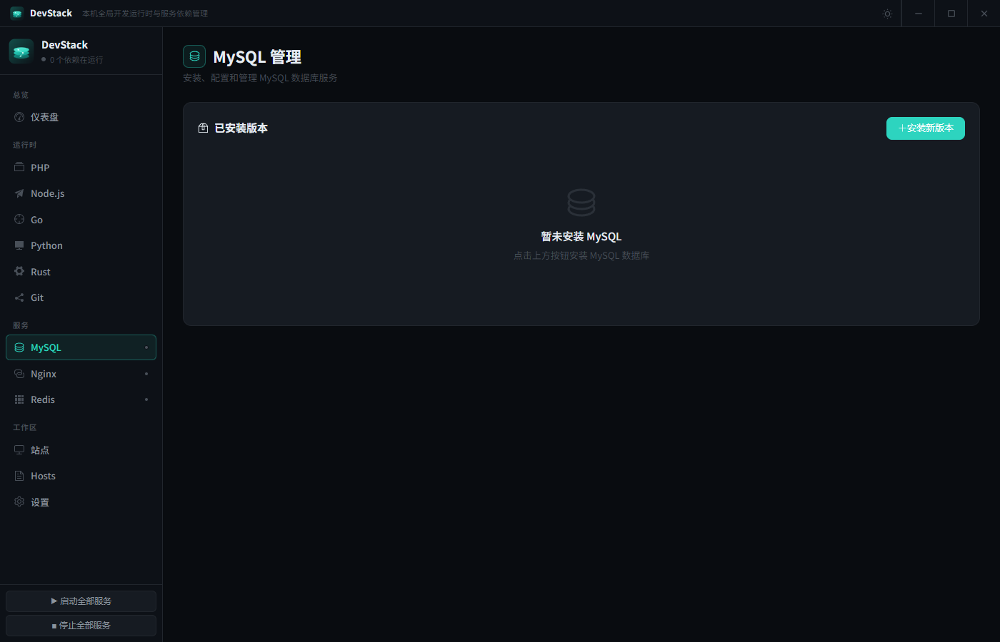
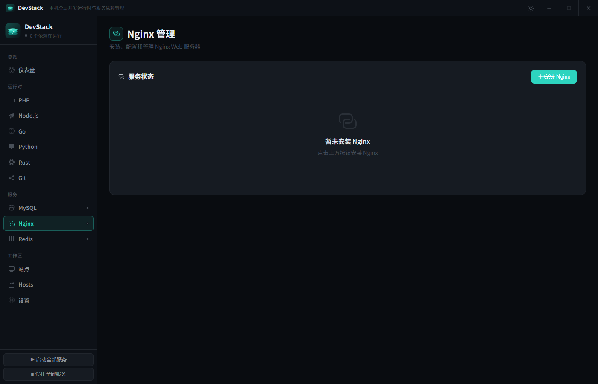
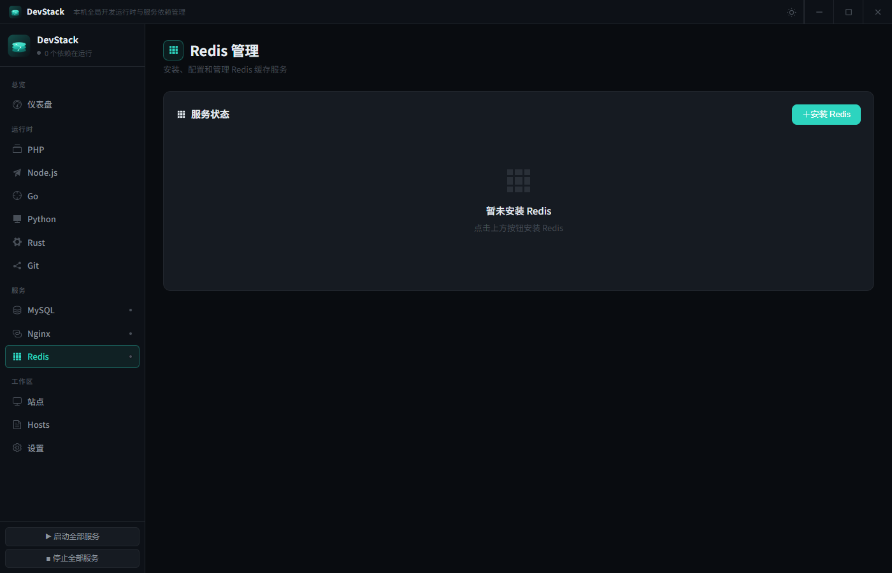
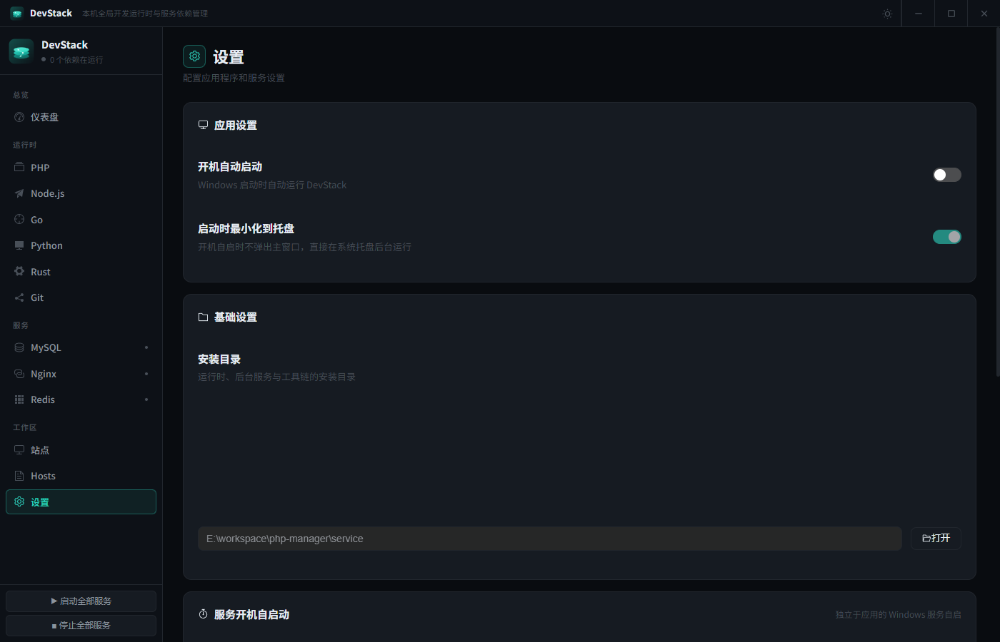

# DevStack

<p align="center">
  
</p>

<p align="center">
  <strong>本机全局开发运行时与服务依赖管理</strong>
</p>

<p align="center">
  在 Windows 上一站管理 PHP、Node.js、Go、Python、Rust、Git，以及 MySQL、Nginx、Redis 和本地站点
</p>

<p align="center">
  <a href="#功能特性">功能特性</a> •
  <a href="#安装使用">安装使用</a> •
  <a href="#使用指南">使用指南</a> •
  <a href="#常见问题">常见问题</a>
</p>

---

## 📸 界面预览

<table>
  <tr>
    <td></td>
    <td></td>
  </tr>
  <tr>
    <td align="center">总览</td>
    <td align="center">PHP 运行时</td>
  </tr>
  <tr>
    <td></td>
    <td></td>
  </tr>
  <tr>
    <td align="center">Node.js 运行时</td>
    <td align="center">Go 运行时</td>
  </tr>
  <tr>
    <td></td>
    <td></td>
  </tr>
  <tr>
    <td align="center">Python 运行时</td>
    <td align="center">MySQL 服务</td>
  </tr>
  <tr>
    <td></td>
    <td></td>
  </tr>
  <tr>
    <td align="center">Nginx 服务</td>
    <td align="center">Redis 服务</td>
  </tr>
  <tr>
    <td colspan="2"></td>
  </tr>
  <tr>
    <td colspan="2" align="center">设置</td>
  </tr>
</table>

## ✨ 功能特性

### 运行时

#### PHP

| 功能         | 说明                                                       |
| ------------ | ---------------------------------------------------------- |
| 多版本管理   | 支持同时安装 PHP 8.1、8.2、8.3、8.4、8.5 等多个版本        |
| CGI 独立控制 | 每个 PHP 版本可独立启动/停止 CGI 进程，支持多版本并行运行  |
| 端口自动分配 | 各版本自动分配端口（如 8.4→9084, 8.3→9083）                |
| 一键切换     | 点击即可切换 PHP 版本，自动配置系统环境变量                |
| 扩展管理     | 可视化管理 PHP 扩展，支持在线安装（从 PECL）               |
| 配置编辑     | 在线编辑 php.ini，无需手动查找配置文件                     |
| 自动配置     | 安装时自动启用常用扩展（curl、gd、mbstring、pdo_mysql 等） |
| Composer     | 集成 Composer 管理，支持镜像源切换（阿里云、腾讯云等）     |
| 日志查看     | 直接查看 PHP 错误日志                                      |
| 下载源       | 从 [windows.php.net](https://windows.php.net) 官方下载     |

#### Node.js

| 功能       | 说明                                         |
| ---------- | -------------------------------------------- |
| 多版本管理 | 支持同时安装多个 Node.js 版本                |
| LTS 支持   | 显示 LTS 版本和 Current 版本标识             |
| npm 集成   | 自动显示对应的 npm 版本                      |
| 一键切换   | 快速切换默认 Node.js 版本，自动配置环境变量  |
| 下载源     | 从 [nodejs.org](https://nodejs.org) 官方下载 |

#### Go

| 功能       | 说明                               |
| ---------- | ---------------------------------- |
| 多版本管理 | 支持同时安装多个 Go 版本           |
| 一键切换   | 切换默认 Go，自动配置 PATH         |
| 系统安装   | 识别并管理本机已有的 Go            |
| 下载源     | 从 [go.dev](https://go.dev) 官方下载 |

#### Python

| 功能       | 说明                                             |
| ---------- | ------------------------------------------------ |
| 嵌入式版本 | 使用免安装的嵌入式版本，不影响系统环境           |
| pip 集成   | 自动配置 pip，支持安装 Python 包                 |
| 多版本管理 | 支持同时安装多个 Python 版本                     |
| 一键切换   | 快速切换默认 Python 版本                         |
| 下载源     | 从 [python.org](https://www.python.org) 官方下载 |

#### Rust

| 功能     | 说明                         |
| -------- | ---------------------------- |
| rustup   | 集成 rustup 工具链管理       |
| 默认工具链 | 切换 / 更新默认 toolchain    |
| 系统识别 | 检测本机已安装的 Rust        |

#### Git

| 功能     | 说明                         |
| -------- | ---------------------------- |
| 版本管理 | 一键安装/卸载 Git for Windows |
| 配置管理 | 可视化配置用户名、邮箱等信息 |
| 环境变量 | 自动配置系统 PATH            |

### 服务

#### MySQL

| 功能       | 说明                                                              |
| ---------- | ----------------------------------------------------------------- |
| 版本支持   | 支持 MySQL 5.7.x 和 8.0.x 系列                                    |
| 服务控制   | 启动、停止、重启 MySQL 服务                                       |
| 密码管理   | 一键修改 root 密码                                                |
| 配置编辑   | 在线编辑 my.ini 配置文件                                          |
| 自动初始化 | 安装时自动初始化数据库，开箱即用                                  |
| 下载源     | 从[阿里云镜像站](https://mirrors.aliyun.com/mysql/)下载，速度更快 |

#### Nginx

| 功能         | 说明                                       |
| ------------ | ------------------------------------------ |
| 版本管理     | 支持多个 Nginx 版本，可随时切换            |
| 服务控制     | 启动、停止、重启、热重载配置               |
| 站点管理     | 可视化添加、删除、启用、禁用虚拟主机       |
| Laravel 支持 | 自动生成 Laravel 项目的伪静态配置          |
| SSL 证书     | 支持申请 Let's Encrypt 免费 SSL 证书       |
| 配置编辑     | 在线编辑 nginx.conf 主配置文件             |
| 下载源       | 从 [nginx.org](https://nginx.org) 官方下载 |

#### Redis

| 功能         | 说明                                                                           |
| ------------ | ------------------------------------------------------------------------------ |
| Windows 版本 | 使用 Windows 原生编译版 Redis                                                  |
| 服务控制     | 启动、停止、重启 Redis 服务                                                    |
| 状态监控     | 实时查看运行状态、内存使用情况                                                 |
| 配置编辑     | 在线编辑 redis.windows.conf 配置                                               |
| 下载源       | 从 [GitHub (redis-windows)](https://github.com/redis-windows/redis-windows) 下载 |

### 工作区

- **快速创建站点** — 填写域名和路径即可创建虚拟主机
- **Laravel 一键配置** — 自动配置 public 目录和伪静态规则
- **SSL 证书申请** — 集成 Let's Encrypt 自动申请
- **Hosts 自动配置** — 自动添加域名到系统 hosts 文件
- **站点日志查看** — 查看每个站点的访问日志和错误日志
- **一键打开站点** — 点击域名在默认浏览器打开
- **Hosts 管理** — 可视化编辑系统 hosts

### 其他

- 开机自启动（静默，无弹窗）
- 服务启动无黑色窗口闪烁
- 深色 / 浅色主题
- 服务状态实时监控
- KeepAlive 页面缓存，切换无闪烁
- 日志查看（Nginx、PHP、MySQL、站点）

## 🛠️ 技术栈

| 技术                                          | 说明         |
| --------------------------------------------- | ------------ |
| [Vue 3](https://vuejs.org/)                   | 前端框架     |
| [TypeScript](https://www.typescriptlang.org/) | 类型安全     |
| [Electron](https://electronjs.org/)           | 桌面应用框架 |
| [Element Plus](https://element-plus.org/)     | UI 组件库    |
| [Vite](https://vitejs.dev/)                   | 构建工具     |
| [Pinia](https://pinia.vuejs.org/)             | 状态管理     |

## 📦 安装使用

### 系统要求

- Windows 10/11 (64 位)
- Node.js 18.0 或更高版本（仅开发/构建需要）
- 管理员权限（管理服务、修改 hosts、写用户 PATH）
- [Visual C++ Redistributable 2015-2022](https://aka.ms/vs/17/release/vc_redist.x64.exe)

### 开发环境

```bash
git clone https://github.com/ethanfly/php-manager.git
cd php-manager

npm install
npm run electron:dev
```

### 构建生产版本

```bash
# 构建 Windows 安装包（自动更新 patch 版本号 +0.0.1）
npm run build

# 指定版本号更新类型
npm run build:patch   # 1.0.0 -> 1.0.1
npm run build:minor   # 1.0.0 -> 1.1.0
npm run build:major   # 1.0.0 -> 2.0.0

# 不更新版本号直接打包
npm run build:nobump
```

构建完成后，安装包生成在 `release` 目录。安装包显示名与快捷方式为 **DevStack**。

## 📁 项目结构

```
php-manager/
├── electron/                    # Electron 主进程
│   ├── main.ts                 # 主进程入口
│   ├── preload.ts              # 预加载脚本（IPC 通信）
│   └── services/               # 运行时 / 服务管理
│       ├── ConfigStore.ts
│       ├── PathManager.ts      # 用户 PATH 安全写入
│       ├── PhpManager.ts
│       ├── MysqlManager.ts
│       ├── NginxManager.ts
│       ├── RedisManager.ts
│       ├── NodeManager.ts
│       ├── GoManager.ts
│       ├── PythonManager.ts
│       ├── RustManager.ts
│       ├── GitManager.ts
│       ├── ServiceManager.ts
│       ├── HostsManager.ts
│       └── LogManager.ts
│
├── src/                         # Vue 前端
│   ├── brand.ts                # 产品显示名（DevStack）
│   ├── App.vue                 # 壳层：标题栏 + 侧栏 + KeepAlive
│   ├── views/                  # 各运行时 / 服务 / 工作区页面
│   ├── stores/serviceStore.ts
│   └── styles/main.scss
│
├── scripts/bump-version.js
├── public/icon.png
└── README.md
```

## 📖 使用指南

### 首次使用

1. 安装 [Visual C++ Redistributable 2015-2022](https://aka.ms/vs/17/release/vc_redist.x64.exe)
2. 以管理员身份运行 DevStack（改 hosts / PATH / 启停服务需要）
3. 在「运行时」或「服务」页点击安装，按需装 PHP、Node.js、Go、MySQL、Nginx 等

### 创建第一个站点

1. 安装并启动 Nginx 和 PHP
2. 进入「站点」
3. 添加站点：名称、域名（如 `myproject.test`）、根目录、PHP 版本；Laravel 项目打开对应选项
4. 浏览器访问 http://myproject.test

### 开机自启动

1. 打开「设置」
2. 开启需要随 Windows 启动的服务
3. 需要时再打开「开机自动启动」让 DevStack 本身进托盘

## ❓ 常见问题

### 为什么需要管理员权限？

用于启动/停止本机服务、修改 hosts、写入用户 PATH。

### PHP 下载很慢？

PHP 走 windows.php.net。也可以手动把 ZIP 解压到 `[安装目录]/php/php-版本号`，重启应用即可识别。

### MySQL 启动失败？

常见原因：3306 被占用、防火墙、数据目录不可写。

### 如何卸载某个运行时或服务？

先停止，再到对应页面点「卸载」。卸载系统里原有的安装前会二次确认。

## 🔗 相关资源

| 软件    | 下载源                                                                 |
| ------- | ---------------------------------------------------------------------- |
| PHP     | [windows.php.net](https://windows.php.net/download/)                   |
| MySQL   | [阿里云镜像](https://mirrors.aliyun.com/mysql/)                        |
| Nginx   | [nginx.org](https://nginx.org/en/download.html)                        |
| Redis   | [GitHub redis-windows](https://github.com/redis-windows/redis-windows) |
| Node.js | [nodejs.org](https://nodejs.org/en/download/)                          |
| Go      | [go.dev](https://go.dev/dl/)                                           |
| Python  | [python.org](https://www.python.org/downloads/windows/)                |
| Rust    | [rustup](https://rustup.rs/)                                           |
| Git     | [git-scm.com](https://git-scm.com/download/win)                        |

## 📄 开源协议

本项目基于 [MIT License](LICENSE) 开源。

## 🤝 贡献

1. Fork 本仓库
2. `git checkout -b feature/AmazingFeature`
3. `git commit -m 'Add some AmazingFeature'`
4. `git push origin feature/AmazingFeature`
5. 提交 Pull Request

问题与建议请开 [Issue](https://github.com/ethanfly/php-manager/issues)。

---

<p align="center">
  DevStack · 本机全局开发运行时与服务依赖管理
</p>
