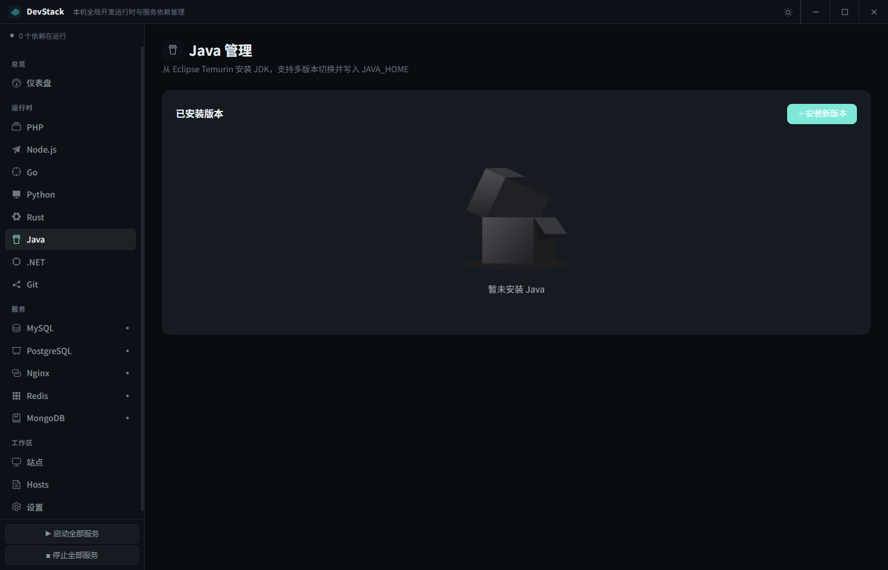
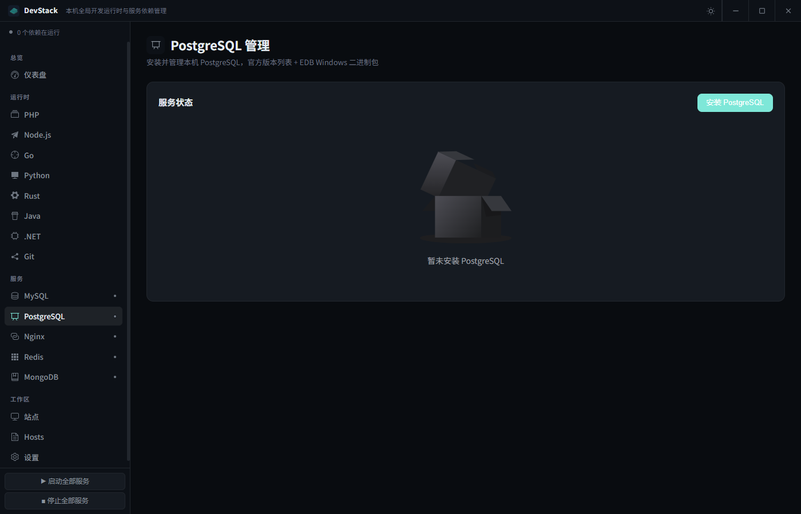
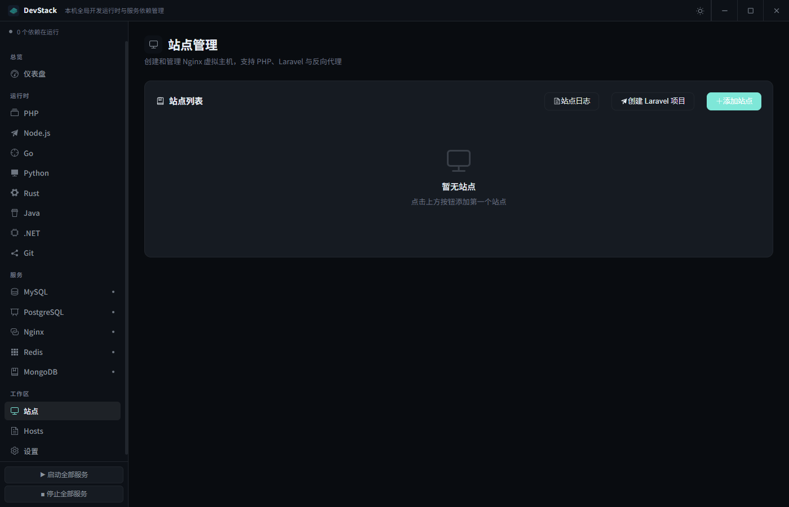

# DevStack

<p align="center">
  
</p>

<p align="center">
  <strong>本机全局开发运行时与服务依赖管理</strong>
</p>

<p align="center">
  在 Windows 上一站安装、切换、启停常用语言运行时与后台服务，并管理本地站点和 hosts
</p>

<p align="center">
  <a href="#功能特性">功能特性</a> •
  <a href="#安装使用">安装使用</a> •
  <a href="#使用指南">使用指南</a> •
  <a href="#常见问题">常见问题</a>
</p>

---

## 📸 界面预览

<table>
  <tr>
    <td></td>
    <td></td>
  </tr>
  <tr>
    <td align="center">总览</td>
    <td align="center">PHP</td>
  </tr>
  <tr>
    <td></td>
    <td></td>
  </tr>
  <tr>
    <td align="center">Node.js</td>
    <td align="center">Java</td>
  </tr>
  <tr>
    <td></td>
    <td></td>
  </tr>
  <tr>
    <td align="center">MySQL</td>
    <td align="center">PostgreSQL</td>
  </tr>
  <tr>
    <td></td>
    <td></td>
  </tr>
  <tr>
    <td align="center">Nginx</td>
    <td align="center">站点 / 反向代理</td>
  </tr>
  <tr>
    <td></td>
    <td></td>
  </tr>
  <tr>
    <td align="center">Redis</td>
    <td align="center">设置</td>
  </tr>
</table>

## ✨ 功能特性

版本列表均从官网动态获取，安装包走官方（或官网指定的 Windows 发行渠道），可装到当前线上最新版。网络失败时回退到内置备用列表。

### 运行时

| 运行时 | 能力 | 下载源 |
| ------ | ---- | ------ |
| **PHP** | 多版本（NTS / TS）、一键切换 PATH、CGI 按版本独立启停（8.4 → 9084）、扩展 / php.ini / Composer | [downloads.php.net](https://downloads.php.net/~windows/releases/) `releases.json` |
| **Node.js** | 多版本、Current + LTS、npm、系统 / mise 安装识别 | [nodejs.org/dist/index.json](https://nodejs.org/dist/index.json) |
| **Go** | 多版本、PATH + `%USERPROFILE%\go\bin`、系统安装识别 | [go.dev/dl](https://go.dev/dl/?mode=json&include=all) |
| **Python** | 官方嵌入式包、自动 pip、多版本切换、系统 / mise 识别 | [python.org/ftp](https://www.python.org/ftp/python/) |
| **Java** | Temurin JDK、多版本、`JAVA_HOME` + PATH、系统 JDK 识别 | [Adoptium API](https://api.adoptium.net/) |
| **.NET** | 官方 SDK zip、多版本、`DOTNET_ROOT` + PATH、系统 SDK 识别 | [Microsoft release-metadata](https://builds.dotnet.microsoft.com/dotnet/release-metadata/releases-index.json) |
| **Rust** | 一键 rustup、channel / 历史版本、更新默认 toolchain | [rustup](https://rustup.rs/) + rust-lang 发行列表 |
| **Git** | PortableGit 便携版、用户名 / 邮箱、PATH（cmd / usr / mingw64） | [Git for Windows Releases](https://github.com/git-for-windows/git/releases) |

PHP 额外能力：

- 安装时自动启用常用扩展（curl、gd、mbstring、pdo_mysql 等）
- 可视化开关扩展，支持从 PECL 安装
- Composer 镜像（官方 / 阿里云 / 腾讯云等）
- 每个已装版本的 CGI 可并行运行

### 服务

| 服务 | 能力 | 下载源 |
| ---- | ---- | ------ |
| **MySQL** | 安装 / 初始化 / 启停、默认 root 密码、在线编辑 my.ini | 官方 CDN（8.0 / 8.4 LTS / 9.x / 26.x） |
| **PostgreSQL** | EDB Windows 二进制包、`initdb`、启停、本机 trust（用户 `postgres`，端口 5432） | [postgresql.org/versions.json](https://www.postgresql.org/versions.json) + EDB zip |
| **Nginx** | 启停 / 重载、虚拟主机、反向代理、本机 HTTPS | [nginx.org](https://nginx.org/en/download.html) |
| **Redis** | Windows 编译版、启停、状态与配置 | [redis-windows](https://github.com/redis-windows/redis-windows)（优先 msys2 便携包） |
| **MongoDB** | Community zip、启停、本机无认证（`mongodb://127.0.0.1:27017`） | [downloads.mongodb.org/current.json](https://downloads.mongodb.org/current.json) |

仪表盘可单独或一键启停已安装服务，侧栏显示运行状态。

### 工作区

- **PHP / Laravel 站点** — 域名、根目录、PHP 版本；Laravel 自动指向 `public` 并写入伪静态
- **反向代理** — 把本地域名转到 Node.js、Go、Vite 等端口（如 `http://127.0.0.1:3000`）
- **本机 HTTPS** — 开启 SSL 时自动签发站点证书，并把 DevStack 本地 CA 导入 Windows 受信任根证书
- **Hosts** — 创建站点时写入系统 hosts，也可在 Hosts 页单独编辑
- **一键打开** — 仪表盘或站点列表点击域名用默认浏览器打开

### 其他

- 用户 PATH 只改本应用托管前缀，写入前备份，带断崖保护
- 开机自启动（静默，无弹窗）
- 服务启动无黑色控制台闪烁
- 深色 / 浅色主题
- KeepAlive 页面缓存
- 日志查看（Nginx、PHP、MySQL、站点）

## 🛠️ 技术栈

| 技术                                          | 说明         |
| --------------------------------------------- | ------------ |
| [Vue 3](https://vuejs.org/)                   | 前端框架     |
| [TypeScript](https://www.typescriptlang.org/) | 类型安全     |
| [Electron](https://electronjs.org/)           | 桌面应用框架 |
| [Element Plus](https://element-plus.org/)     | UI 组件库    |
| [Vite](https://vitejs.dev/)                   | 构建工具     |
| [Pinia](https://pinia.vuejs.org/)             | 状态管理     |

## 📦 安装使用

### 系统要求

- Windows 10/11（64 位）
- Node.js 18 或更高（仅开发 / 构建需要）
- 管理员权限（启停服务、改 hosts、写用户 PATH、导入本机 CA）
- [Visual C++ Redistributable 2015-2022](https://aka.ms/vs/17/release/vc_redist.x64.exe)

### 开发环境

```bash
git clone https://github.com/ethanfly/php-manager.git
cd php-manager

npm install
npm run electron:dev
```

```bash
npm run typecheck
npm test
```

### 构建生产版本

```bash
# 构建 Windows 安装包（会改写 package.json 版本号）
npm run build

# 指定版本号更新类型
npm run build:patch   # 1.0.0 -> 1.0.1
npm run build:minor   # 1.0.0 -> 1.1.0
npm run build:major   # 1.0.0 -> 2.0.0

# 不更新版本号直接打包
npm run build:nobump
```

产物在 `release/`。安装包显示名与快捷方式为 **DevStack**。

开发下载与数据目录在项目下的 `service/`；安装版使用与应用目录平级的 `service/`。

## 📁 项目结构

```
php-manager/
├── electron/
│   ├── main.ts                 # 窗口、托盘、IPC
│   ├── preload.ts              # contextBridge API
│   └── services/
│       ├── catalog.ts          # 官网版本列表
│       ├── httpClient.ts       # 跟随重定向的下载 / HEAD
│       ├── PathManager.ts      # 用户 PATH 安全写入
│       ├── ConfigStore.ts
│       ├── PhpManager.ts
│       ├── NodeManager.ts
│       ├── GoManager.ts
│       ├── PythonManager.ts
│       ├── JavaManager.ts
│       ├── DotnetManager.ts
│       ├── RustManager.ts
│       ├── GitManager.ts
│       ├── MysqlManager.ts
│       ├── PostgresManager.ts
│       ├── NginxManager.ts
│       ├── RedisManager.ts
│       ├── MongoManager.ts
│       ├── SslManager.ts       # 本机 CA + 站点证书
│       ├── ServiceManager.ts
│       ├── HostsManager.ts
│       └── LogManager.ts
├── src/
│   ├── brand.ts                # 显示名 DevStack
│   ├── App.vue                 # 标题栏 + 侧栏 + KeepAlive
│   ├── views/
│   ├── stores/serviceStore.ts
│   └── styles/main.scss
├── tests/                      # identity + 官网目录解析
├── public/icon.png
└── README.md
```

## 📖 使用指南

### 首次使用

1. 安装 [Visual C++ Redistributable 2015-2022](https://aka.ms/vs/17/release/vc_redist.x64.exe)
2. 以管理员身份运行 DevStack
3. 在侧栏「运行时」或「服务」安装需要的组件（PHP、Node.js、Java、MySQL、PostgreSQL、Nginx 等）
4. 需要进 PATH 的运行时点「设为默认」，新开终端后生效

### 创建站点

**PHP / Laravel**

1. 安装并启动 Nginx 和对应 PHP
2. 打开「站点」→ 添加，类型选 PHP 或 Laravel
3. 填写域名（如 `myproject.test`）、根目录、PHP 版本
4. 浏览器访问 `http://myproject.test`

**反向代理**

1. 先在本机跑起目标进程（例如 Vite `:5173`、Node `:3000`）
2. 添加站点，类型选「反向代理」，填写代理地址
3. 用本地域名访问该端口服务

**本机 HTTPS**

创建或编辑站点时打开「启用 SSL」。DevStack 会签发叶子证书，并把本地 CA 写入 Windows 受信任根证书存储，浏览器访问 `https://你的域名` 时不再报警。

### 开机自启动

1. 打开「设置」
2. 按需打开随 Windows 启动的服务
3. 需要时再打开「开机自动启动」，让 DevStack 进托盘

## ❓ 常见问题

### 为什么需要管理员权限？

启停本机服务、改 hosts、写用户 PATH、把本地 CA 导入受信任根证书。

### 版本列表是空的或不是最新？

列表从官网实时拉取。检查网络后关掉安装对话框再打开；失败时会使用备用列表。PHP 也可以把官方 ZIP 解压到 `[安装目录]/php/php-版本号`，重启后识别。

### MySQL / PostgreSQL / MongoDB 启动失败？

端口被占用（3306 / 5432 / 27017）、数据目录不可写或未完成初始化。看对应服务页提示和 `service/logs`。

### 如何卸载？

先停止服务，再到对应页点「卸载」。卸载系统里原有的安装前会二次确认。

### PATH 被改乱了？

每次写入前会备份到 `[安装目录]/path_backup.txt`。DevStack 只会改自己托管目录下的条目，不会清掉用户其它 PATH。

## 🔗 相关资源

| 软件       | 下载源                                                                 |
| ---------- | ---------------------------------------------------------------------- |
| PHP        | [downloads.php.net](https://downloads.php.net/~windows/releases/)      |
| Node.js    | [nodejs.org](https://nodejs.org/en/download/)                          |
| Go         | [go.dev/dl](https://go.dev/dl/)                                        |
| Python     | [python.org](https://www.python.org/downloads/windows/)                |
| Java       | [Adoptium Temurin](https://adoptium.net/)                              |
| .NET SDK   | [.NET 下载](https://dotnet.microsoft.com/download)                     |
| Rust       | [rustup.rs](https://rustup.rs/)                                        |
| Git        | [Git for Windows](https://github.com/git-for-windows/git/releases)     |
| MySQL      | [cdn.mysql.com](https://cdn.mysql.com/Downloads/)                      |
| PostgreSQL | [postgresql.org](https://www.postgresql.org/download/windows/)         |
| Nginx      | [nginx.org](https://nginx.org/en/download.html)                        |
| Redis      | [redis-windows](https://github.com/redis-windows/redis-windows)        |
| MongoDB    | [MongoDB Community](https://www.mongodb.com/try/download/community)    |

## 📄 开源协议

本项目基于 [MIT License](LICENSE) 开源。

## 🤝 贡献

1. Fork 本仓库
2. `git checkout -b feature/AmazingFeature`
3. `git commit -m 'Add some AmazingFeature'`
4. `git push origin feature/AmazingFeature`
5. 提交 Pull Request

问题与建议请开 [Issue](https://github.com/ethanfly/php-manager/issues)。

---

<p align="center">
  DevStack · 本机全局开发运行时与服务依赖管理
</p>
